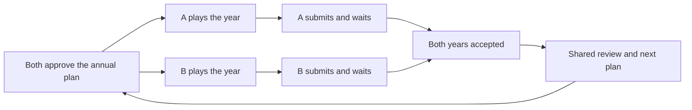

# Multiplayer proposal for Electrify

Draft, 14 October 2026. Scope: a small friends co-op mode, with a path to longer asynchronous campaigns.

**Yes: multiplayer can use very little infrastructure.** The strongest fit is Firebase Authentication, Firestore, and a small serverless coordinator, with Steam providing desktop identity and invitations. Each player runs the simulation locally. The backend records agreements, saves completed years, and opens the next year; it does not run a continuous game server.

The important design choice is what players trade. **Independent yearly play works with power agreements fixed before the year starts. Trading a partner's changing, actual surplus requires a shared simulation clock or more frequent synchronization.** A year-end reconciliation cannot repair a blackout that already changed customers, cash, and construction decisions in February.

Start with two players, complementary neighboring grids, a small existing intertie, and a six-to-eight-year co-op scenario. Prototype annual agreements backed by dedicated wind or solar production. Test whether planning together is enjoyable before building production networking. If players mainly want to rescue one another during emergencies, choose synchronized play instead.

## The player experience

The promise is: **Run neighboring grids together. Play each year at your own pace, meet to plan the next year, and build power agreements you can rely on.**

One player might have good wind resources and winter demand; the other might have strong solar resources and summer demand. Give them comparable grid sizes and different investment opportunities. Both should remain useful throughout the match.

Each year has a short shared planning phase, independent operation, and a shared review:

1. **Plan together.** Review last year's shortages and costs. Choose next year's power agreement, propose a line upgrade, and agree who pays. Both approve the same plan.
2. **Play independently.** Pause, change speed, build, manage customers, and respond to supported local events. Committed power and shared projects follow the agreed plan throughout the year.
3. **Finish the year.** Stop at the exact December boundary and submit the completed year. Submission locks that year's result. The first player can review results and draft proposals while waiting.
4. **Review together.** After both submissions, see the combined outcome and plan the next year. A draft never changes an already-running year.



The current simulation has 1,152 representative ticks per year: twelve representative days at fifteen-minute intervals. At NORMAL speed, uninterrupted playback takes roughly 69 seconds before rendering overhead; pauses and decisions will determine actual session length. A six-to-eight-year scenario is a useful first playtest size, not a measured session-length claim. See [the clock constants](../src/Constants.tsx).

Use a shared objective: both grids must remain solvent, meet a service threshold, and reduce combined emissions by the final year. Show individual contributions such as delivered power, funded infrastructure, and reliability improvements. Require each grid to meet its service floor, so a large successful utility cannot hide its partner's collapse. Remove the existing decision-count requirement from this mode; making unnecessary moves should not help the team.

Avoid competitive profit rankings initially. Monopoly pricing, withholding help, and transferring cash to manufacture a winner work against this co-op premise. Start with an automatic, published contract price and a simple choice of cost split for joint construction. Negotiated prices and competition can follow if players actually want them.

## What determines import and export capacity

Separate three things in the interface:

| Quantity                                   | Meaning                                    | What increases it                                                      |
| ------------------------------------------ | ------------------------------------------ | ---------------------------------------------------------------------- |
| Wire capacity in MW                        | The physical ceiling on the connection     | Completing a joint line or upgrade                                     |
| Reserved generation in MW                  | The named production assigned to the buyer | Reserving more eligible generation                                     |
| Delivered power in MW at a particular time | Production actually reaching the buyer     | Available reserved production and available wire at that calendar tick |

For the first prototype, use one direction per line per year and omit transmission losses, consistent with the current model's lack of a separate sending-end and receiving-end loss calculation. Reverse direction at a later annual meeting if desired.

```text
G(t) = output of the committed export project at calendar tick t
W(t) = completed shared line rating, after its predetermined availability adjustment
F(t) = min(G(t), W(t))

buyer receives F(t)
seller's domestic grid cannot use F(t)
seller retains any unsent production G(t) - F(t)
```

`G(t)` comes from specific committed assets and the agreed simulation inputs. Remove the designated project's production from ordinary domestic generation and add only `G(t) - F(t)` to the seller's domestic dispatch before storage and shortage calculations. Buyer-side spill never returns power to the seller. The curve is not the seller's nameplate total, unused thermal capacity, last year's annual surplus, customer count, or latest wall-clock status. A larger wire creates a higher ceiling, not more generation. This preserves the existing separation between wire capacity and neighboring supply described in [intertie balance](intertie-balance.md).

For example, Alice reserves a 40 MW solar project for Bob through a 25 MW line. When that project produces 32 MW, Bob receives 25 MW and Alice retains 7 MW. When it produces 12 MW, Bob receives 12 MW. At night he receives zero. If the line is derated to 10 MW, Bob receives at most 10 MW. Display **25 MW connection; variable solar supply; zero guaranteed minimum**, alongside seasonal forecasts. Do not present 25 MW as firm capacity available during any shortage.

Integrate energy using Electrify's existing representative-day weighting. A 10 MW calendar-tick flow is power, not 10 MWh, and twelve representative days do not mean that an annual contract delivers only twelve real days of energy. Use the same time conversion for delivered energy, operating costs, payments, and emissions on both sides.

### Make the export project independent of local choices

A locked sell or pause button is insufficient. Current generation can also change with aging, story effects, hazards, and resilience decisions. The committed project therefore needs a complete immutable production descriptor, evaluated through shared pure generation helpers. Include its capacity, location, age, weather inputs, eligible event effects, and line availability in the annual plan.

Begin with designated wind and solar projects in a purpose-built multiplayer scenario. A committed project or asset fraction operates separately from the seller's discretionary domestic fleet for that year. Its reserved capacity cannot also be counted as normal local generation. Local retrofits, fuel policies, damage responses, sales, or shutdowns cannot change its contracted output. Model any supported shared outage in the fixed descriptor, identically for both players. Unsupported events and assets should be unavailable in this initial scenario.

This isolation is a deliberate game rule and real implementation work. Reusing arbitrary facilities from every existing scenario would greatly expand the scope. Start with whole designated export projects if splitting ordinary facilities proves difficult to explain or implement.

After both players lock the plan, produce one immutable calendar curve and its hash. Both simulations use that curve, regardless of which person reaches March first. Show forecasts during planning and reveal actual output through normal play. Trusted clients will possess enough information to inspect future production; this mode should not promise competitive weather secrecy.

A seller cannot reclaim promised delivery during a local shortage. Explain that consequence before approval: **This production is committed to your neighbor until next year.** If that rule feels frustrating rather than strategic in playtests, the annual model needs changing.

### Payments and shared construction

Use a fixed annual reservation fee for the initial product. The buyer pays for access to the variable output, whether it is consumed, stored, or spilled. Set the fee from forecast delivered MWh after the line constraint and a published pricing rule; do not charge Bob for congestion overflow retained by Alice. Before approval, show the fee, forecast delivered energy, estimated effective price per MWh, and seller's foregone domestic supply. Disclose that the buyer bears renewable and line-availability risk. Escrow the fee when both approve the plan, and release the seller's receipts on a fixed schedule during the year. The seller cannot spend the entire future annual revenue in January.

Before unlocking the year, also reserve the designated project's and shared line's full-year operating and maintenance costs from the agreed contributions and fee escrow. Their operation must remain funded even if the owner's domestic utility goes bankrupt. Withdraw those costs once from the reserve before releasing spendable seller receipts; avoid charging the domestic ledger again. Because the charge is fixed before operation, buyer curtailment cannot change a seller's already-played finances. There is no post-year bill capable of making earlier construction unaffordable. Distinguish the supply reservation fee from each side's line maintenance contribution.

A line is one shared project with one capacity, cost, and completion date. Both approve their contributions; the coordinator reserves those amounts atomically. Neither can cancel the other person's committed investment. New capacity becomes usable at the first annual boundary after construction completes. Show that date before purchase. Keep the starting line useful from year one so players experience cooperation immediately.

Try an initial wire around 15–25% of the smaller grid's opening peak demand. This is a calibration hypothesis. Fix actual MW in scenario data after playtesting; do not automatically grow it with customers. Make upgrades compete with useful domestic investment.

The first curated scenario should use the player connection without NPC trading corridors. That keeps accounting and incentives understandable while testing the core idea. Buyer storage remains useful, but there is no resale market or circular trading. Adding ordinary regional markets later requires explicit rules for contracted flows, spot imports, exports, and storage arbitrage.

### Products to consider later

| Product                             | Advantage                                                 | Additional obligation                                                               |
| ----------------------------------- | --------------------------------------------------------- | ----------------------------------------------------------------------------------- |
| Seasonal or daytime delivery blocks | Both players can specialize and help in different periods | Reserve every asset and line interval once; define direction and netting explicitly |
| Firm scheduled power                | Reliable import capacity and a richer supplier role       | Export-aware thermal dispatch, fuel funding, and a real shortfall/default mechanism |
| Coupled spot trading                | Actual surplus and emergency assistance                   | Common simulation time or synchronized sub-year steps                               |

A firm agreement can work with an external balancing market that fills the seller's shortfall and charges scarcity prices. That is a different model: the two players are backed by a third supplier. It needs full exposure collateral, or an explicit credit/default guarantor. A liability cap alone cannot preserve guaranteed delivery without someone absorbing the remaining cost. Replacement-power emissions also need settlement rules. Defer this until the simpler product earns its complexity.

Do not simulate both years independently and replace their results with a joint replay afterward. Different imports can change earlier blackouts, customer growth, cash, and the legality of later decisions. Provisional results followed by rewritten outcomes would be hard to trust.

## Steam and Firebase options

| Approach                                                     | Infrastructure and cost                                            | Reliability and maintenance                                                        | Fit                                                     |
| ------------------------------------------------------------ | ------------------------------------------------------------------ | ---------------------------------------------------------------------------------- | ------------------------------------------------------- |
| Steam lobby and peer networking                              | No developer-operated game server; local host and saves            | Implement reconnects, save distribution, host departure, and resume ownership      | Same-session Steam friends who accept a designated host |
| Firestore with client writes and Security Rules              | Potentially within the free plan                                   | Complex shared agreement and transition rules; clients still supply economic truth | Disposable prototype with existing web login            |
| Firestore and a small serverless coordinator                 | Billed Firebase plan; usage-based storage, requests, and functions | Durable shared state, one transition authority, no permanent player host           | Recommended for resumable matches                       |
| Steam identity and invitations plus the Firebase coordinator | Same backend plus a Steam authentication bridge                    | One game protocol across desktop and web; additional native integration            | Recommended desktop path                                |

Steam provides lobbies and relayed peer networking, but a lobby disappears after everyone leaves. It is not a durable asynchronous match database. Steam Cloud synchronizes account saves; do not use it as a shared transactional match ledger. A Steam-only version can save locally and resume when its host returns, but that product depends on that person's availability. See [Steam lobbies](https://partner.steamgames.com/doc/features/multiplayer/matchmaking) and [Steam Cloud](https://partner.steamgames.com/doc/features/cloud).

For any later peer transport, use Valve's modern NetworkingMessages or NetworkingSockets APIs. The old `ISteamNetworking` API is deprecated. Browser crossplay through Steam's relay is not automatic; it has separate integration requirements. See [Steam networking](https://partner.steamgames.com/doc/features/multiplayer/networking) and [relay requirements](https://partner.steamgames.com/doc/features/multiplayer/steamdatagramrelay).

Firestore's push updates are enough for readiness, plan revisions, and annual results. There is no need for a second Realtime Database, a tick stream, a WebSocket service, Kubernetes, or a dedicated game-server fleet. The recommendation is based on avoiding persistent hosts and recovery protocols; platform marketing alone does not establish overall reliability.

### Authentication and invitations

The web game already uses Google sign-in. Keep that for a web playtest. Steam desktop currently skips Firebase initialization entirely, so desktop multiplayer needs an explicit opt-in service path.

For Steam, obtain a Web API authentication ticket in the native process. A server endpoint verifies it with Valve for the intended app and service identity, applies the ownership policy, and issues a Firebase custom token for a stable Steam-derived user ID. Keep publisher credentials server-side. A client-supplied Steam ID or display name proves nothing. See [Steam authentication](https://partner.steamgames.com/doc/features/auth) and [Firebase custom tokens](https://firebase.google.com/docs/auth/admin/create-custom-tokens).

Initially join by a private invite code. Later, a Steam invitation can carry that join intent; the server still authorizes admission and membership. A code is not permission to read arbitrary matches. Crossplay does not require linking a person's Google and Steam identities in the first version; use explicit account linking later if needed.

For longer asynchronous campaigns, Steam also offers Game Notifications for turn prompts. Those calls require a hosted server and a publisher key, so they can be an optional coordinator feature rather than a separate notification service. Their session metadata references game state on the developer's backend; keep actual checkpoints and agreements in Firestore. See [Steam Game Notifications](https://partner.steamgames.com/doc/features/game_notifications) and [session API](https://partner.steamgames.com/doc/webapi/IGameNotificationsService).

The existing native layer owns Steam's manual callback dispatcher. The installed `steamworks.js` methods are not automatically compatible with that choice. Prove ticket callbacks and invitation handling with the existing dispatcher; do not initialize a second callback loop. See [desktop distribution](desktop-steam.md), `electron/steam-native.cjs`, and `electron/steam-dispatch.cjs`.

## The smallest durable backend

Use one serverless deployment package with authentication exchange and authenticated match commands. The coordinator owns membership, plan approvals, reservations, year progression, and published manifests. Clients own local play. The designated export-project evaluator is a small shared deterministic module; it should reuse generation calculations rather than duplicate the economics. Package and load its versioned simulation data before calling weather or fuel helpers from the server, as the headless simulator does. Use the existing seeded random and portable power helpers to preserve cross-platform results.

Keep the shared head small and store payloads separately:

| Record                    | Contents and purpose                                                                                                                                        |
| ------------------------- | ----------------------------------------------------------------------------------------------------------------------------------------------------------- |
| Match head                | Two members, phase, year, revision, supported rules/protocol, latest manifest and result references                                                         |
| Planning revision         | Proposals and both approvals over the same content hash                                                                                                     |
| Annual input              | Immutable project descriptor, delivery curve, fixed payments, line schedule, seeds, and starting checkpoint references                                      |
| Player submission         | Immutable checkpoint reference, predecessor hash, declared start/end tick, rules/protocol digest, action delta, input hash, submission type, and command ID |
| Annual result             | Accepted submission references, contribution summary, shared ledger, and next planning revision                                                             |
| Private checkpoint chunks | Bounded recovery payloads, readable only by the intended member and service                                                                                 |

Listen only to the match head and current small planning/result records. Download history and checkpoints on demand. Do not put full saves into every readiness notification. Firestore documents are limited to 1 MiB; the current save transport already chunks payloads, but multiplayer needs its own permissions, retention, and acceptance semantics. See [Firestore limits](https://firebase.google.com/docs/firestore/quotas) and [existing cloud saves](cloud-saves.md).

### Accept each transition once

1. Persist the local completed year and an outbox command ID before uploading.
2. Send a bounded packed checkpoint and action delta to `submitYear`. The service structurally validates, hashes, and chunks it outside a transaction. Check the match/player identity, previous accepted checkpoint hash, start/end ticks, rules/protocol digest, and annual input hash against the immutable input. A normal submission must cover the unlocked year and end at its exact boundary; terminal submissions declare their failure tick and status separately. Repeated identical commands return the previous acceptance; different content for an accepted player/year is rejected.
3. In one transaction, read and validate the match, year, input hash, membership revision, and previous acceptance, then atomically write the immutable chunks, manifest, and accepted reference. A readiness acknowledgement means server acceptance, not an offline pending write.
4. `tryAdvance` reads both accepted submissions and atomically creates the one annual result and moves the head to planning. It cannot advance the same year twice or charge a shared purchase twice.
5. Both players approve an identical next-year planning hash. The coordinator freezes the new input and unlocks the next year. Each client applies its shared ledger entries once using their stable IDs.

No simulation or external request belongs inside a retryable transaction. Generate curves and validate larger payloads first, then publish only against the unchanged planning/input revision. Choose a strict encoded payload/write-count limit comfortably below Firestore's 10 MiB transaction request limit, with opaque fields unindexed; validate it against the largest supported eight-year checkpoint before release. Atomic acceptance avoids staged blobs and orphan cleanup. A rejected oversized submission preserves local progress and offers recovery/export; it must never be labeled ready. See [Firestore transactions](https://firebase.google.com/docs/firestore/manage-data/transactions) and [request limits](https://firebase.google.com/docs/firestore/quotas).

After an acceptance, invoke the idempotent advancement path. Any connected or reconnecting client can also request it. If every client closes before advancement, the accepted submissions remain durable and advancement runs on the next visit. The prototype does not promise that a clock-driven event runs while everyone is offline, so it needs no scheduler. If background triggers are added, handle their at-least-once and unordered delivery explicitly. See [Firestore trigger guarantees](https://firebase.google.com/docs/functions/firestore-events).

Plan approval is equally strict: an edit invalidates both approvals. The first approval does not freeze a partner out; the second matching approval commits the plan atomically. A no-trade, no-new-construction plan is always a valid proposal, while already committed projects retain their obligations. Expired supply reservations never auto-renew. Both players still approve the default; without agreement, save and exit or explicitly leave for a solo continuation. No timeout spends money or signs a contract. Avoid a separate ready system that can approve one revision and start another.

### Authority and cheating

The first version is private, friendly, and unranked. The coordinator enforces shared agreements, membership, bounded requests, and once-only transitions. It accepts structurally valid local economic checkpoints from trusted clients. A hash detects inconsistency; it does not prove that cash, facilities, or actions were earned. A malicious client can still falsify its own economy and undermine the match.

Keep multiplayer outcomes separate from official single-player leaderboards. If open matchmaking or meaningful competitive scores become necessary, replay each submitted year server-side from its previously verified checkpoint. The real reducer and seeded replay machinery are useful foundations, but the current simulator is a testing harness, not a ready production verifier. Packaging simulation assets, rejecting illegal actions, preserving runtime versions, and measuring cold-start/CPU cost would become required work.

### Disconnection and departure

| Situation                                | Behavior                                                                                                                              |
| ---------------------------------------- | ------------------------------------------------------------------------------------------------------------------------------------- |
| Connection drops during an unlocked year | Continue and save locally; shared approval/submission waits for reconnection                                                          |
| Submission response is lost              | Retry the same outbox ID and query its durable acceptance                                                                             |
| Both players close the game              | Preserve the match and resume from accepted checkpoints/local in-year saves                                                           |
| A player is absent or stuck              | Preserve the campaign; offer save and exit rather than a forced timer                                                                 |
| A player explicitly leaves               | End the shared campaign and allow the other person to create a labeled solo continuation                                              |
| Bankruptcy or another terminal failure   | Accept a terminal snapshot and publish the co-op outcome; preserve the partner's current year and offer review or a solo continuation |

Avoid automatic unattended play in the first version. A do-nothing bot can bankrupt an absent utility and punish its partner. Also avoid a live NPC takeover, which requires operating the departed player's grid and honoring its previous decisions.

For a solo continuation, preserve the remaining current-year delivery curve and already-set payments as a detached contract through December, then retire player trading. Do not delete promised power in the middle of someone else's year. A continuation is a new solo save and cannot reconnect to the original campaign. If no one explicitly leaves, the original match simply waits; no host may silently evict a partner and rewrite its history.

A terminal submission moves the match to a failed/closing state instead of requiring the failed player to reach December. It ends future shared progression, while the prefunded export project, delivery curve, and fixed ledger remain in force for the partner's current year. Keep accepting the returning partner's bounded progress for recovery or review in that state. Let them finish the year for review or create the solo continuation immediately. Publish the failure with its actual tick; do not invent paired final statistics when the grids ended at different dates. Never roll the partner's local year backward or wait forever for a failed utility's impossible year-end submission. An explicit departure uses the same durable terminal transition.

Cross-device recovery resumes from the last accepted annual checkpoint. Finer recovery requires an explicit in-year upload, with a size/cadence cap. Do not advertise continuous cloud recovery when only local autosave and annual uploads exist.

## Cost and maintenance

The design has low operating cost because it communicates at planning and year boundaries. It still needs a maintained backend, access rules, dependency/runtime updates, logs, and a release policy.

Firestore currently includes 50,000 reads/day, 20,000 writes/day, 1 GiB storage, and 10 GiB monthly outbound transfer for one eligible database per project. These allowances are shared with existing features in that project. Functions deployment requires Blaze even if usage fits no-cost allowances. See [Firestore billing](https://firebase.google.com/docs/firestore/pricing) and [Functions setup](https://firebase.google.com/docs/functions/get-started).

For an illustrative budget, assume each two-player match-year uses **150 reads and 50 writes**, including modest planning activity and small checkpoint chunks. These are planning allowances, not measured usage. At Iowa's listed on-demand rates of $0.03/100,000 reads and $0.09/100,000 writes, assuming otherwise unused daily free quotas and a 30-day month:

| Eight-year matches completed per day | Reads per day | Writes per day | Monthly document read and write charges |
| -----------------------------------: | ------------: | -------------: | --------------------------------------: |
|                                   10 |        12,000 |          4,000 |                                      $0 |
|                                  100 |       120,000 |         40,000 |                             About $1.17 |
|                                1,000 |     1,200,000 |        400,000 |                            About $20.61 |

These figures exclude functions, authentication, storage, bandwidth, deletion, deployment artifacts, monitoring, and extra retries/reconnects. Rates depend on region; use the existing database's actual region before budgeting. See [regional Firestore pricing](https://cloud.google.com/firestore/pricing).

Payload size may matter more than document operations. Retaining an illustrative 100 KiB checkpoint for each player for each of eight years consumes 1.56 MiB per match before indexes and other records. A thousand retained matches exceed the 1 GiB allowance. Keep the latest two accepted checkpoints per player, bounded action deltas and shared manifests; measure real sizes and trim older payloads only after the new result is durable. Mark pruned recovery payloads as expired in their historical manifests, so missing bytes do not look like corruption. Download private checkpoints on recovery, not on every partner status update.

Use zero minimum function instances, bounded maximum instances, per-account match and command limits, small request/action caps, narrow listeners, and a retention policy for abandoned matches and superseded checkpoints. Disable indexing on opaque payloads. Show a clear retry state with bounded backoff if a service limit is reached. Firebase advertises function no-cost allowances, but compute, networking, and deployment storage have their own billing dimensions; a complete dollar estimate needs a measured full-match trace. See [Firebase pricing](https://firebase.google.com/pricing).

Alerts-only budgets do not stop spending. Current spend-cap budgets support Functions and several other Firebase services, but Firestore is not among the listed services. Use available caps alongside access controls and alerts; do not promise a guaranteed total bill ceiling. A reached function cap pauses multiplayer commands, so preserve local progress and make resumption clear. See [Firebase billing controls](https://firebase.google.com/docs/projects/billing/avoid-surprise-bills).

### Releases are the larger maintenance constraint

Electrify currently carries saves and challenges forward to new rules, and deploys frequently. That policy cannot silently change one member's multiplayer simulation halfway through a year. The broad compatibility digest also changes after some harmless edits. See [run compatibility](run-compatibility.md).

Every match must record protocol, save schema, full simulation digest, calendar, and content versions. Reject mismatched year submissions with a recoverable update/compatibility state. For the private same-session playtest, use one fixed build and avoid replacing it while sessions are active.

Before public multi-day campaigns, choose one supported policy: retain versioned application/data/runtime assets for the bounded lifetime of active matches, or implement an explicit migration at an annual boundary acknowledged by both players. An old client must be able to complete its current year under the old rules before migration. The existing silent carry-forward behavior does not provide this guarantee. Set the maximum supported campaign lifetime and retention window before promising long-running games.

This release policy, event isolation, and dependable recovery are likely to cost more engineering time than Firestore traffic. Serverless hosting removes machines to operate; it does not remove these product obligations.

## Implementation and playtest plan

### First test the game without networking

Build a local two-grid harness using the real reducer, dedicated export projects, and the annual manifest. Keep the calculations in shared helpers and honor the existing `StoreRegistry` import boundary. Exercise two independent grids with different action sequences and speeds.

Run paired playtests with a small starting line, visible project reservations, an annual fee, and one upgrade choice. Test the annual model against a simple common-clock alternative on paper or in the harness. The decisive question is whether players enjoy coordinating, not whether the network can transfer a save.

Initial success criteria, to revise from observation:

- Players can explain wire MW versus variable delivered power after the first year.
- Each player changes an investment or operating plan because of the partner at least twice in the short scenario.
- Both players have useful contributions; stronger renewable resources do not make the other player a spectator.
- Early finishers usually have less than about a minute of idle waiting in a live session, and can leave safely if the partner needs longer.
- Players prefer another co-op match to equivalent independent runs. If feedback is “single-player with waiting,” revise the coupling before adding more players.

Use simulation sweeps to compare no trading, a sensible contract, overcommitment, maximal line upgrades, and selfish domestic investment. A fixed NPC offer with identical prices/output is a useful control: human planning should add enjoyment beyond receiving a discount. Try correlated bad weather as well as complementary weather. Buying the largest intertie must not solve the scenario automatically.

### Then prove the durable protocol

Implement Firestore commands and rules against the emulator, using existing web authentication first. Prove atomic plan approval, reservations, immutable submission acceptance, re-entry, and solo continuation. Then prove Steam-ticket exchange through the existing native dispatcher with two real Steam accounts. Add Steam invitations after join-by-code works. A successful mock is not a live Steam acceptance test.

Reliability gates should include duplicated/conflicting commands, concurrent final submissions, a crash before or after atomic acceptance, a lost acceptance response, reconnect after everyone closes, stale planning approvals, account switching, unauthorized match reads, oversized payloads, mid-year terminal submissions, and mixed-build submissions. Do not accept cached readiness as authority. Require the same completed-year hashes across Windows, Linux, and browser runs with identical inputs. Add a small inspection command for stuck matches; correction must use the same guarded protocol rather than hand-editing cash or year counters.

### Integrate the narrow multiplayer mode

| Existing area                               | Proposed work                                                                                            |
| ------------------------------------------- | -------------------------------------------------------------------------------------------------------- |
| `src/Types.tsx` and new pure helpers        | Annual manifests, designated export projects, shared ledger entries, conservation and validation         |
| `src/reducers/Game.tsx`                     | Year-end stop, frozen external curve inputs, once-only shared payments, and multiplayer failure handling |
| `src/helpers/Transmission.ts`               | Keep NPC surplus trading distinct from the new contracted delivery product                               |
| `src/SaveGame.tsx`, save repository, replay | Match/year binding, local outbox, accepted checkpoint restore, replay input manifests                    |
| `src/Globals.tsx` and desktop bridge        | Optional multiplayer Firebase service and verified Steam authentication                                  |
| New backend package and Firestore rules     | Auth exchange, match commands, payload validation, project curves, retention, permissions                |
| New multiplayer screens                     | Join, annual plan, compact partner status, submission/retry, shared review                               |

The current dispatch exports already-produced surplus and leaves unused thermal capacity idle. Contracted production therefore requires an explicit dispatch/input integration; substituting the partner's demand into an NPC offer is insufficient. Current replay checkpoints mostly track monthly cash, so a multiplayer state hash needs a canonical, broader definition. See [game dispatch](../src/reducers/Game.tsx), [transmission helpers](../src/helpers/Transmission.ts), and [replay](../src/Replay.tsx).

Keep team carbon accounting separate from the sum of player scores: count generation and construction once, with transfers identified. Existing local-plus-imported totals would otherwise count bilateral production again at the receiver. Apply the same conservation discipline to money including escrow, generated energy, imported energy, and spilled energy. Distinguish source-side wire overflow retained locally from buyer-side spill. Show the importing player's financial and infrastructure contributions alongside the seller's power contribution.

For implementation, require reducer/helper tests, contract conservation invariants, emulator rules/protocol tests, paired headless scenarios, `npm run sim -- --all`, and the normal `npm run check`. Browser checks should cover the annual boundary, reconnect, and readable desktop/phone planning in light and dark modes. Add backend deployment/runtime checks separately; the current root check has no serverless service to validate.

### Expand only after the first mode works

Consider seasonal directions and more export project types first. Four players, arbitrary scenarios, public matchmaking, ranked competition, firm thermal supply, and continuous spot markets each introduce distinct design and operational work. Longer asynchronous campaigns also need the release policy above. Keep those decisions separate so the initial experiment remains small enough to finish and evaluate.

## Review findings

The proposal was challenged by separate game-design and technical-feasibility reviewers, with particular attention to enjoyment, low operating cost, maintenance, and recovery.

| Review round | Main challenge                                                                                                       | Result                                                                                                                                                    |
| ------------ | -------------------------------------------------------------------------------------------------------------------- | --------------------------------------------------------------------------------------------------------------------------------------------------------- |
| 1            | Annual synchronization cannot reconcile changing live surplus; Steam lobbies do not persist an unattended campaign   | Use fixed annual agreements and durable Firestore state                                                                                                   |
| 2            | Locking facility controls does not isolate events; small document charges hide payload and versioning work           | Use designated immutable export projects, bounded checkpoint submission, and an explicit release policy                                                   |
| 3            | Owner failure can strand a year; fee escrow alone does not fund delivery; staged uploads add avoidable recovery work | Accept terminal snapshots, prefund project operation, price forecast delivered energy, provide a no-trade plan, and accept bounded checkpoints atomically |
